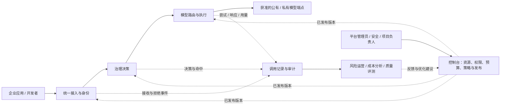

# ZenRouter 业务架构草案

> 状态：讨论稿 v0.1。依据[产品需求基线](product-requirements.md)整理业务能力及边界；这是业务架构，不代表技术组件、服务拆分、技术选型或交付承诺已经确定。
>
> 后续细化：[业务模块拆分（HTML）](business-modules.html)，按组织与权限、安全与审计、模型与路由、额度与成本四个一级模块归并本文能力；模块拆分不等同于技术服务拆分。

## 1. 一句话定位与闭环

ZenRouter 位于企业应用与获准模型服务之间，围绕**一次 AI 调用**完成「接入身份 → 判断能否调用 → 检查内容 → 在合规候选中路由 → 执行及故障处理 → 记录与计费 → 风险复核与优化」的闭环。所有“全量”均指**经过网关的调用覆盖范围**；正文由企业选择不留存、部分／脱敏或完整留存，并单独限定企业内部或获准外部存储。

图中的模块是**业务责任划分**，不是必须分别部署的微服务。

## 2. 业务主体与关键对象

| 业务对象 | 含义与关键关系 |
| --- | --- |
| 企业／组织／项目／应用 | 管理归属、授权、预算、可见性及费用归因的层级；具体租户和组织模型待定。 |
| 认证主体／虚拟密钥 | 应用访问网关的身份；凭证本体与审计标识分离，上游凭证不暴露给应用。 |
| 模型目录／端点 | 模型能力与供应商／私有实例；描述协议、流式、工具调用、结构化输出、上下文长度、地域等能力。 |
| 业务模型别名 | 应用稳定使用的模型入口，映射到经权限、安全及能力筛选的候选。 |
| 策略版本 | 路由、安全、权限、预算与记录策略的生效快照；一次调用要能追溯实际版本。 |
| 逻辑请求／上游尝试 | 一次应用调用对应一个 `request_id`，重试或 Fallback 产生多个 `attempt_id`，且各自可能产生费用。 |
| 安全判断／风险事件 | 对输入、输出或工具参数的检测结果与处置；风险事件关联原请求、证据、检测器及规则版本。 |
| 用量／预算占用／结算 | 区分估算、实际上游用量与待对账状态；按组织、项目、应用等维度归因。 |
| 管理审计事件 | 策略、权限、预算、密钥、记录配置变更，以及敏感原文查看／导出的证据。 |

## 3. 业务能力地图

| 业务域 | 核心责任 | 主要用户 |
| --- | --- | --- |
| 接入与身份 | 统一 API、协议兼容、虚拟密钥、认证、组织／项目／应用归属及模型授权。 | 开发者、项目负责人、平台管理员 |
| 模型资源管理 | 供应商／私有端点接入、凭证引用、模型能力、健康状态与业务模型别名。 | 平台管理员 |
| 治理决策 | 基于身份、模型能力、地域、安全、预算等强约束筛选候选；决定路由、超时、重试、Fallback，并给出解释。 | 项目负责人、平台管理员 |
| 内容安全与策略 | 输入／输出／工具参数检测、脱敏、拦截、受约束重路由；规则版本、观察、试跑、灰度和回滚。 | 安全人员、平台管理员 |
| 调用执行与可靠性 | 模型请求转换和响应处理、流式输出、取消、错误分类、重试／熔断／切换。 | 开发者、平台管理员 |
| 成本与预算 | 预算预占、结算与异常释放、限流、价格版本、消耗归因、异常告警与对账。 | 成本管理人员、项目负责人 |
| 记录与审计 | 接收元数据、请求与尝试链、管理操作审计、可配置正文留存与存储边界、获准原文访问及完整性监控。 | 开发者、审计人员 |
| 风险运营 | 事件检索、证据查看、人工复核、处置流转、误报及检测失败分析。 | 安全／审计人员 |
| 质量与优化 | 业务评测集、反馈、回放、影子流量、A/B、成本与质量对比及策略优化。 | 项目负责人、平台管理员 |
| 平台运维 | 私有部署、配置发布与恢复、运行健康、积压、告警和备份恢复。 | 平台管理员、运维人员 |

**边界原则：**权限、安全和地域约束先确定“允许做什么”，路由优化只在获准候选中决定“选哪个”。预算不是单纯报表；审计不是普通访问日志；风险复核不能改写原检测结果。

## 4. 三条业务链路

### 4.1 接入与发布链路（控制侧）

1. 平台管理员登记供应商／私有端点、能力与凭证引用，维护模型目录及业务模型别名。
2. 管理员配置组织、项目、应用与角色；项目负责人申请或配置虚拟密钥、授权模型及预算。
3. 安全人员配置检测器、安全规则及异常策略；平台与项目负责人配置路由和记录策略。
4. 策略以**草稿 → 校验／试跑 → 观察／灰度 → 正式生效 → 回滚**管理版本，并记录操作者、变更摘要与生效范围。
5. 调用链路使用已验证的生效配置；控制侧短暂不可用时，配置有效期及撤权、密钥撤销、预算一致性等边界需另行设计。

### 4.2 单次调用链路（运行侧）

1. 收到请求，生成 `request_id` 并可靠留下**接收记录**；包括后续鉴权拒绝、校验失败与安全拦截。认证凭证不得写入日志。强留痕场景下记录不可用应执行明确的拒绝策略。
2. 完成认证、应用归属、模型授权与请求能力校验；确定适用策略版本及允许的候选集合。
3. 执行输入及工具参数的同步检测，按策略放行、脱敏、阻断或限制候选；保留原始内容与实际发送内容的变换关系（保存原文的范围由记录策略决定）。
4. 检查限流并预占预算，在能力、地域、权限与安全约束内选定端点，记录候选排除与选择依据。
5. 发起上游 `attempt_id`；按错误类别和总耗时／次数上限重试或 Fallback。每次尝试分别记录状态、耗时及已发生的用量。
6. 对输出执行适用的同步检查，处理流式释放与中途阻断、取消、断流等状态；已经释放的内容不能撤回，也不能无提示拼接另一份模型响应。
7. 返回最终结果，补齐逻辑请求记录，完成预算结算、释放或待对账标记；异步检测可追加风险事件，但不改写当时已执行的动作。

**异常口径：**检测失败显示“未检测／检测失败／部分检测”，不视为通过；记录缺失、用量未知及不完整流式结果分别标识。重试增加上游尝试数及可能的费用，不增加逻辑请求数。

### 4.3 运营与优化链路（分析侧）

1. 请求记录汇集身份、输入／输出、路由理由、尝试链、安全结果、用量、策略版本和完整性状态。
2. 安全人员检索风险、查看获授权的证据，追加人工判断和处置记录；原检测结论保持可追溯。
3. 成本人员核对预算、估算／实际用量和价格版本；管理员监控可靠性、记录积压及检测失败。
4. 在质量评测集与业务反馈具备后，比较规则与候选方案；影子流量和 A/B 仍服从权限、地域、内容安全及费用归因约束，评估后再发布新版本。

## 5. P0／P1 的业务切面（建议，非排期）

- **P0：可受控试点的闭环。**应用拿虚拟密钥接入首批模型 → 在强约束内路由并可靠调用 → 所有进入网关的请求可追溯 → 输入／输出基础风险检测与策略处置 → 预算预占结算、审计和基础风险复核 → 私有部署与恢复验证。
- **P1：可验证的优化与运营。**质量评测集、影子流量、A/B、动态路由优化、成本归因深化、历史重扫、复杂检测组合和风险处置闭环。
- **明确边界：**首期不承担 GPU 调度、完整 Agent 编排、模型转售商城或所有多模态附件的深度内容检测；工具调用可检查模型提出的参数，实际工具执行控制需执行端或 MCP 网关配合。

## 6. 建议先画的三个关键业务页面

已形成[初版可点击原型](prototype.html)，对应页面、交互范围和业务模块映射见[原型说明](prototype-plan.md)。以下关键页面已纳入首版，其他复杂功能仍待详细设计。

1. **请求详情：**以 `request_id` 为中心，串联身份、原始／实际内容、路由解释、尝试、流式完整性、用量、安全命中与策略版本。
2. **安全策略编辑与发布：**作用范围、检测位置、条件、动作、异常行为、冲突提示、试跑、观察／灰度和版本回滚。
3. **风险事件复核：**多次检测关联同一调用，展示脱敏证据、人工复核、处理轨迹与敏感原文访问审计。

## 7. 下一轮需要业务确认的问题

1. 首个试点是哪个应用／团队？首批模型、客户端协议、流式与工具调用需求是什么？
2. 项目仅供内部使用，还是计划向外部企业交付？组织和租户如何隔离？
3. 请求／响应正文、附件及风险证据的默认留存模式、期限、地域与原文查看权限是什么？
4. 检测超时、预算未知、记录不可用和流式中途风险各默认采取什么动作？
5. 企业／项目策略冲突如何裁决，谁能发布、紧急回滚和批准例外？
6. 预算采用什么币种、口径、预占容差及对账周期？
7. 怎样衡量业务质量、允许多大延迟与成本、何时终止实验？

上述问题确定后，再细化权限矩阵、请求状态机、策略优先级、字段字典、验收指标与技术架构。
