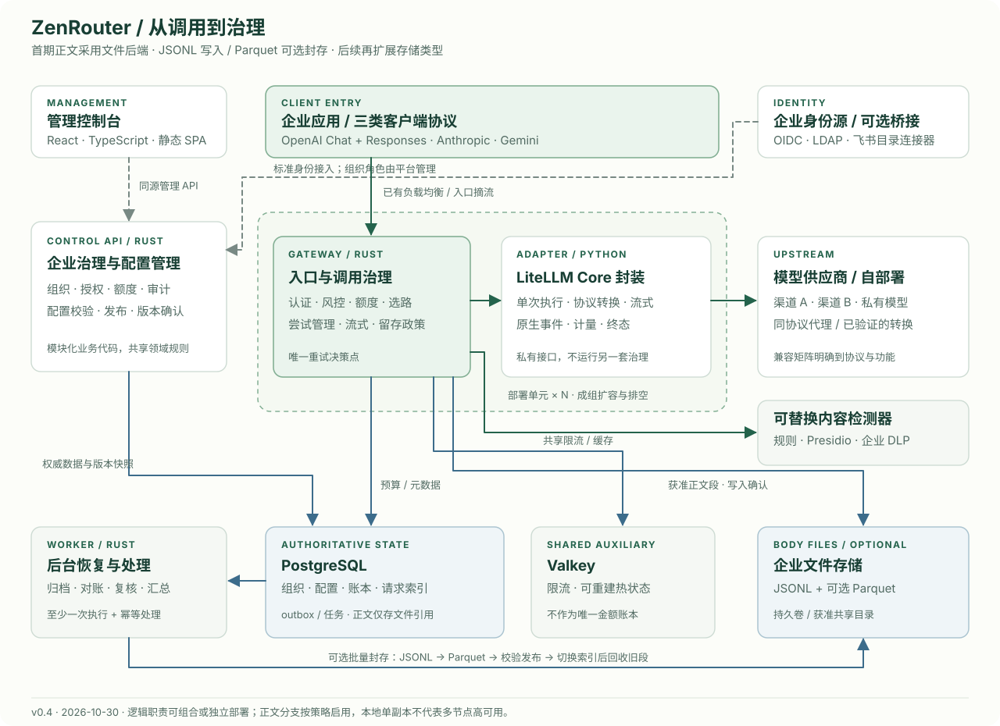
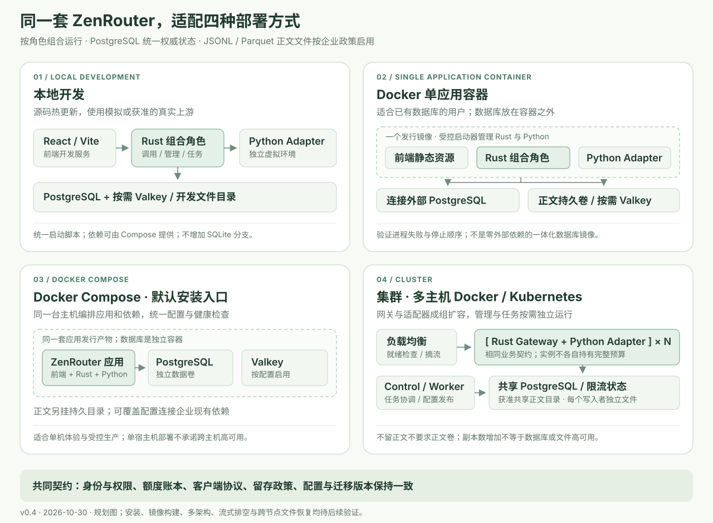

# ZenRouter 技术选型与总体架构

2026-10-30 · v0.4 · 架构建议稿 · 纳入本地开发、Docker 单应用容器、Compose 与集群交付规划

## 1. 建议采用的总体路线

**Rust 自有网关与治理核心 + Python 模型适配组件 + React 管理控制台 + PostgreSQL 权威数据 + 按企业策略启用的正文存储。** 业务代码按四大模块划分，运行角色分为调用、管理和后台任务，可组合或独立运行；先建立可验证的完整业务闭环，再按实际瓶颈拆分服务。

这份文档把已有调研收敛为默认方案，保留关键替代选项。Rust 优先但不要求全栈同语言；选择性复用 LiteLLM SDK，保持 ZenRouter 的公共 API、路由、权限、额度与审计独立。依赖版本在骨架阶段通过锁文件固定；业务组件、生产规模和服务指标仍需后续验证。

| 决策 | 首版建议 | 状态与边界 |
| --- | --- | --- |
| 产品与业务域 | 组织与权限、安全与审计、模型与路由、额度与成本；平台运维横向支撑 | 延续已对齐范围；原型页面不等同于微服务 |
| 调用核心 | Rust，Tokio + Axum + Tower；治理规则由自有领域代码执行 | 作为调用核心默认选择；真实业务与流式链路待验证 |
| 代码组织 | 单仓库多语言 + Rust Cargo workspace + 模块化业务核心 + 轻量分层 | 作为首版代码组织基线；依赖版本、细粒度接口和运行能力继续验证 |
| 模型适配 | 内部 Python 服务封装 LiteLLM Core SDK，一次执行一个已选定的上游尝试 | 不启动第二套完整 Proxy 管理体系；不内嵌 Python 解释器 |
| 管理端 | React + TypeScript + Vite，静态 SPA；复用成熟表格和表单组件 | 保留原型的信息结构与绿色主题，原型脚本不直接视为生产代码 |
| 权威状态 | PostgreSQL 事务记录身份归属、配置、额度、结算和审计索引 | 缓存、日志聚合和分析库都不能自行改写权威余额 |
| 正文策略 | 企业选择不留存、部分／脱敏留存或完整留存；选择内网或获准外部存储 | 内容范围与存储位置独立配置；对象存储可以在企业内部 |
| 正文落地 | 首期文件后端，JSONL 记录获准内容，Parquet 作为可选批量封存格式 | 不默认把正文写进 PostgreSQL；仅对获准数据执行可靠写入与归档 |
| 多实例 | 每个网关部署单元配套适配进程，入口使用已有负载均衡；统一共享状态 | 可横向扩展；上游配额、数据库和存储不会随实例数自动扩容 |
| 部署交付 | 一套代码与版本化镜像支持本地开发、Docker 单应用容器、Compose、集群 | 四类正式支持目标；单应用容器连接外部 PostgreSQL，Compose 编排完整依赖 |

## 2. 技术选项与默认组合

| 技术部位 | 默认选择 | 主要依据与代价 | 何时考虑替代 |
| --- | --- | --- | --- |
| Web 控制台 | React + TypeScript + Vite；React Router 管理页面，TanStack Query 管理服务端状态 | 静态 SPA 可内置应用镜像或独立托管，前后端契约清晰；需组织权限视图和错误状态 | 团队已有成熟 Vue 标准时可替换；没有 SSR 需求时不增加独立渲染服务 |
| UI 组件 | Ant Design 作为表格、表单、抽屉与日期组件首选，主题令牌适配现有原型 | 缩短管理端基础交互开发；复杂调用详情仍需自有组件 | 组件行为或体积不满足实际界面时逐项替换，不先自建完整组件库 |
| Rust HTTP 与异步 | Tokio + Axum + Tower | Axum 与 Tokio／Tower 集成，便于统一中间件；流式超时、取消和业务约束仍需自建 | 只有协议或性能实测出现明确缺口，才比较其他 Rust 框架 |
| 数据访问 | SQLx + PostgreSQL，迁移文件随代码版本管理 | SQL 与事务边界可审查；连接池、编译检查和离线构建配置需要一起管理 | 不同时引入第二套 ORM；复杂查询需求出现后再评估 |
| Python 适配 | LiteLLM Core SDK + 精简 ASGI 服务，FastAPI 为包装层候选 | 复用模型转换与流式能力；增加进程、编码、取消和部署边界 | Core 固定版本依赖不满足时，可在隔离环境暂用常规 SDK；原生 Rust 组件只替换已验证链路 |
| 登录与授权 | Rust OIDC 客户端；可选 Keycloak 桥接；casbin-rs 优先 | 企业登录可复用，业务权限独立；身份目录与授权缓存需同步 | 复杂属性策略比较 Cedar；关系共享成为主要需求时比较 OpenFGA |
| 同步内容检查 | Rust 本地规则 + 检测器接口；Presidio 为首个敏感信息检测候选 | Python／HTTP 检测器可独立扩容；中文效果与延迟需评测 | 按需求加入企业 DLP、语义分类器或 NeMo，不默认把整条调用交给检测框架 |
| 权威数据库 | 企业支持的 PostgreSQL 稳定版本，首个验证候选为 18 系列 | 事务支持预算与业务状态；高写入与热点部门会产生争用 | 达到明确压力门槛后拆分审计存储；专用账本不是首版必需项 |
| 缓存与共享限流 | Valkey，生产多实例部署建议接入 | 保存可重建状态和限流计数；不提供权威金额语义 | 小规模开发可不启用；严格限额不可用普通异步复制缓存独立保证 |
| 正文存储 | 首期企业指定的本地持久卷／挂载目录；JSONL 追加写入，可选 Parquet 批量封存 | 保留存储与格式接口，先验证轮转、检索、到期清理和崩溃恢复 | 后续再扩展 S3 等后端；不留正文时不启用此分支 |
| 后台处理 | Rust Worker + PostgreSQL 任务表／outbox，限量领取和重试 | 减少首期依赖，重放语义自行控制 | 任务积压或日志吞吐证明需要后，再选专用持久队列／CDC |
| 分析与检索 | PostgreSQL 索引定位正文文件，游标分页与受控汇总；Parquet 供后续批量分析 | 初期不部署额外分析集群，文件不是全文搜索引擎 | 后续按负载评估 ClickHouse 等分析系统，正文搜索另定范围 |
| 部署与观测 | 本地开发、Docker 单应用容器、Compose、集群四类交付；同一运行时按角色组合；OpenTelemetry + Prometheus | Compose 为单机默认安装路径；集群支持多主机 Docker 与后续 Helm 包装 | 集群不强制 Kubernetes；四种交付均须分别验收，第 10 节列出工程任务 |

技术事实依据：[Axum](https://docs.rs/axum/latest/axum/)、[Tower](https://docs.rs/tower/latest/tower/)、[SQLx](https://docs.rs/sqlx/latest/sqlx/)、[Vite](https://vite.dev/guide/)、[React 的应用构建选项](https://react.dev/learn/creating-a-react-app)、[Ant Design](https://ant.design/docs/react/introduce)、[TanStack Query](https://tanstack.com/query/latest/docs/framework/react/overview)。这些组件支持上述基础能力；组合与取舍是本项目的工程建议，不是官方对 ZenRouter 的认证。

LiteLLM Core 官方说明保留模型转换、流式、用量等 SDK 能力，但不带完整网关 CLI／管理界面，并与常规 litellm 分发包使用重叠文件。因此每个适配环境只安装一种分发包；不把完整 Proxy 功能自动当作 SDK 能力。[LiteLLM Core](https://docs.litellm.ai/docs/litellm_core)。身份、检测、存储候选的许可与替代项沿用[三模块调研](governance-research.html)。

## 3. 总体架构与信任边界

图中实线为调用或数据访问，虚线为身份接入与控制关系。PostgreSQL 是逻辑权威存储，生产部署需另配合适的复制、切换和备份；图中的一个数据库框不表示单机部署。

图中 Gateway、Control API、Worker 和 Adapter 表示逻辑职责。单机交付可由一个应用容器组合运行，集群可按角色独立运行；四种部署共享业务规则、数据库 schema 与协议契约，具体映射见第 10 节。

正文日志、归档与历史内容分析是受策略控制的分支。不留存正文时跳过这些写入；必要的预算、计量和管理审计按各自策略独立处理。

| 运行单元 | 主要责任 | 不承担的责任 |
| --- | --- | --- |
| 控制台 SPA | 配置与查询、功能工作台、权限视图、风险复核和费用展示 | 不直连数据库、正文文件或模型供应商；隐藏按钮不能替代后端授权 |
| Control API · Rust | 身份接入、四模块管理接口、配置校验发布、受控查询与导出 | 不成为每个 Token 必经的集中转发节点 |
| Gateway · Rust | 多协议入口、可信身份、治理检查、预算、路由、尝试生命周期与流式输出 | 不在内存维护独立权威额度；不让底层 SDK 隐式选择供应商 |
| Adapter · Python | 对选定端点发起一次调用、转换协议、输出原生数据和规范化计量／终态 | 不再管理组织、虚拟密钥、层级预算和自主 fallback |
| Worker · Rust | 可靠任务、正文归档、结算恢复、风险重扫、汇总、对账及导出 | 不因任务重试自动重发计费状态不明的模型调用 |
| Detector · 可选服务 | 按约定输入执行敏感信息或语义检测 | 不授予业务权限；不成为不受地域和成本约束的数据外发通道 |

企业员工／应用与平台入口是第一道边界，Rust 网关与适配器／检测器是第二道边界，平台与外部身份和模型服务是第三道边界。员工身份、应用归属和组织范围从认证结果建立，不能直接信任客户端自报的部门或用户标头。

首版优先采用单企业私有部署。数据结构保留明确的 organization_id 与资源归属，支持企业内部隔离；对外多租户 SaaS 的跨租户基础设施、计费与运维不自动纳入首版交付。

## 4. 四模块与代码组织基线

### 4.1 首版组织范式

代码组织收敛为：**Monorepo（单仓库多语言）+ Cargo workspace（Rust 包统一管理）+ 模块化业务核心 + 轻量领域分层 + 按角色组合运行。** 本节作为后续搭建项目骨架的基线；这个决定不依赖生产容量测试完成，也不表示所有技术选项与运行能力已经验收。

| 维度 | 首版约定 | 对开发与交付的含义 |
| --- | --- | --- |
| 仓库 | 前端、Rust 核心、Python 适配、契约、迁移和部署文件放在同一仓库 | 跨语言变更可以在一次评审中完成，发行时统一记录组件版本 |
| Rust 工程 | 根目录 Cargo workspace，稳定模块作为成员 crate | 统一依赖约束、Cargo.lock、工具链和检查入口；目录名不等于独立服务 |
| 业务划分 | 组织与权限、模型与路由、安全与审计、额度与成本四个领域 | 按业务职责维护规则、数据归属和公开接口 |
| 内部分层 | 接入层 → 应用层 → 领域层；存储和外部连接实现应用层定义的接口 | 预算与策略规则可独立测试，HTTP 框架、SQL 和供应商 SDK 的变化集中在边界 |
| 运行形态 | Rust 核心采用模块化单体代码组织，Gateway／Control API／Worker 可组合或分开运行 | 单容器与集群复用同一套领域规则；进程拆分不重新划分业务归属 |
| 语言边界 | Rust 掌握业务与治理，Python 独立进程封装 LiteLLM，前端使用 TypeScript | 跨语言通过版本化协议交互，各自管理依赖和锁文件 |

Cargo workspace 提供成员包统一管理、共享锁文件及依赖配置能力；它只管理 Rust 工程，前端与 Python 仍使用各自的构建体系。[Cargo 官方工作空间说明](https://doc.rust-lang.org/cargo/reference/workspaces.html)。仓库布局与分层方式是 ZenRouter 的项目决策。

### 4.2 领域职责与调用边界

| 业务域 | 主要领域能力 | 权威数据 | 原型对应入口 |
| --- | --- | --- | --- |
| 组织与权限 | 外部身份绑定、组织成员、应用身份、角色范围、撤权与委派 | 身份映射、组织关系、角色绑定、网关凭证摘要与状态 | 组织成员、应用密钥、角色授权、身份接入 |
| 模型与路由 | 业务别名、端点能力、价格版本、路由筛选、重试与缓存策略 | 模型目录、渠道映射、兼容矩阵、已发布路由快照 | 模型渠道、路由策略、缓存兼容、质量实验 |
| 安全与审计 | 检测策略、处置、接收与尝试证据、原文授权、复核和生命周期 | 策略版本、请求索引、内容引用、风险与管理审计事件 | 调用记录、安全策略、风险复核、审计留存 |
| 额度与成本 | 分配、预占、结算、归因、价格应用、对账和调整 | 额度账户、分配记录、预占、结算分录、供应商对账状态 | 额度分配、成本分析、供应商对账 |

Rust 采用模块化单体代码组织，运行时支持组合启动与按角色启动 Gateway、Control API、Worker。首期采用一个 Rust 可执行程序承载可选角色，发布镜像包含配套 Python Adapter 和已构建的前端静态资源；集群按角色启动同一发行产物，不为了部署形态维护四套业务实现。共享领域库包含授权、额度、证据等规则；各运行单元通过应用用例和领域接口执行操作，不各写一套扣费算法，也不随意跨域更新表。

控制面与调用面可以独立扩容和发布，但它们必须使用兼容的契约与数据迁移。共享数据库不意味着所有进程使用同一超级用户账号；按读写职责分配数据库权限，调用正文与额度操作采用分开的连接池和资源上限。

### 4.3 目录与依赖约定

| 规划仓库位置 | 职责 |
| --- | --- |
| Cargo.toml、Cargo.lock、rust-toolchain.toml | Rust 工作空间、依赖锁与工具链基线；具体版本在骨架阶段验证后锁定 |
| apps/console | 正式 React 管理控制台；现有 HTML 原型继续留在 docs |
| crates/domain-* | identity、routing、security、billing 领域模型与不变量 |
| crates/application | 按业务组织用例，编排跨域操作，定义事务边界和所需存储／外部服务接口 |
| crates/gateway、crates/control-api、crates/worker | 请求与协议处理、管理接口、任务领取与执行入口，调用应用用例 |
| crates/storage | PostgreSQL、Valkey 与文件后端，按领域分子模块，实现应用层持久化接口 |
| crates/integrations | Python Adapter、身份源、检测器等外部连接的 Rust 实现 |
| crates/contracts | 版本化传输类型；与 api 中的规范通过生成或契约测试保持一致 |
| crates/runtime | 可执行入口、角色选择、配置加载、依赖装配、进程监督和退出编排 |
| adapters/litellm、detectors | Python 适配及可选检测器封装，分别锁定依赖 |
| api、migrations、deploy、tests | OpenAPI／内部事件 schema、迁移、部署清单、契约与集成验证 |

入口层依赖 application 和所需传输契约，application 依赖 domain-*。storage 与 integrations 实现 application 中的接口，由 runtime 装配具体实现。领域规则保持与 Axum、SQLx、Python SDK 及具体存储协议解耦；传输 DTO 与领域模型分别维护，转换发生在接入边界。

同一进程中的业务协作使用普通 Rust 调用，跨语言适配才经过约定的内部协议。跨域用例由应用层编排，写操作通过负责该数据的领域用例执行。事务边界由用例定义、持久化层实现；PostgreSQL 与正文文件之间的恢复仍遵循第 8 节，代码分层不会令它们自动成为同一事务。

结构体、枚举和函数表达业务，trait 主要用于存储、模型调用、检测器等真实替换边界。每个稳定领域先建立清晰模块，内部子目录随实际用例增加；共享代码以明确复用需求为依据。通过 crate 依赖方向、模块可见性、领域测试和契约测试保护边界。

前端在 apps/console 内按四个业务域组织功能，复用公共组件、请求客户端与布局；Python 封装在自己的包中，通过依赖锁跟踪 LiteLLM。前端类型和跨语言数据结构依据同一协议规范同步，避免手写多份不一致的协议定义。

### 4.4 已收敛与仍待验证的范围

单仓库、Rust 工作空间、四领域归属、分层依赖、Python 进程边界及运行角色组合，作为首版代码组织基线。具体 crate API、数据库表、Python／前端包管理工具和依赖版本，在骨架与薄链路验证中落实；协议覆盖、性能、多实例一致性及恢复能力继续按第 12 节验收。

## 5. 一次调用怎样完成

| 阶段 | 处理与持久化 | 失败边界 |
| --- | --- | --- |
| 1. 接收 | 分配可信 request_id，校验大小和协议，记录允许的最小元数据；在正文政策未确定前不持久化正文 | 无法解析／超限请求只记录可获取元数据及未采集原因；错误文本不能泄漏正文 |
| 2. 身份与配置 | 验证网关密钥或可信应用身份，确定部门、模型权限、留存范围与允许存储目标；生成获准视图，需强留痕的输入在上游执行前可靠保存 | 未认证或无有效策略时不留正文；必需政策缺失／冲突按明确规则拒绝，不猜测放行 |
| 3. 输入治理 | 执行输入／工具参数检测；需要计费的检测先取得自身预算 | 拦截不发模型请求；检测失败按显式策略处理，不显示为安全 |
| 4. 选路与预占 | 在能力、权限、地域和安全允许的候选中选择渠道，通过短事务检查并占用全部适用层级额度 | 成本无法给出可信上界时不能冒充严格预算；无合格候选则明确失败 |
| 5. 单次尝试 | 先登记 attempt_id 与发送意图，再调用适配器；适配器只执行这个已选尝试 | 崩溃发生在发送附近时状态可能不确定，不能仅凭没有成功回执认定未调用 |
| 6. 输出处理 | 解析原生协议事件并检查；获准且要求强留痕的视图经可靠确认后才释放；不留正文时不进入正文持久化分支 | 已释放内容不可撤回；按策略不留存、部分保存与异常丢失分别表示 |
| 7. 重试判断 | 仅在允许错误、未释放内容、次数／总时限／预算均满足时创建新 attempt_id | SDK 隐藏重试关闭；安全拒绝不能通过换供应商绕过；未知旧尝试预占不随意释放 |
| 8. 终态与结算 | 按协议结束事件判定完整性，补齐计量；原子结算并写 outbox，Worker 负责归档和汇总 | HTTP 200 不等于完整流；缺失用量保留未知和待对账状态 |

内部重试只由 Gateway 决定。Python SDK、HTTP 客户端、入口负载均衡都应避免偷偷重放可能计费的模型请求；实际关闭方式进入契约测试。客户端自行重试是另一笔到达请求，除非接入明确的、按身份与请求内容约束的幂等协议，否则不能承诺只调用一次。

## 6. 多协议与适配器契约

外部同时提供 OpenAI Chat、OpenAI Responses、Anthropic Messages、Gemini 原生入口。按下游所选协议返回，入口与上游协议分别建模。兼容性以“客户端协议 × 上游模型／端点 × 功能”为单位发布，不能用一个“支持 OpenAI”覆盖全部协议差异。

内部首选 HTTP 加版本化流式事件契约。采用协议原生 payload 与统一的生命周期／计量信封并存的方式，不把全部内容压缩成 OpenAI Chat 的最小字段集合。确切事件编码、HTTP 版本和二进制传输方式在薄链路验证后冻结；首版不因服务内部通信就强制增加 gRPC。

| 契约元素 | 必须表达的含义 |
| --- | --- |
| 调用身份 | request_id、attempt_id、协议家族、契约版本；不以客户端 trace 字段替代身份 |
| 已选目标 | 模型版本、endpoint_ref、credential_ref、能力与价格版本；不接收任意外部自报 URL 作为可调用端点 |
| 执行约束 | 最长时限、输出上限、取消、背压与缓冲限制；一次适配调用只对应一次登记的上游尝试 |
| 流式数据 | 原始事件顺序、工具增量、必要扩展字段及不透明签名；归一化检查视图不能覆盖原生证据 |
| 终态和计量 | 完成／取消／超时／协议中断，输入输出和可获得缓存用量，计量来源与缺失原因 |

同协议链路尽量保留原生能力；需要脱敏或阻断时采用明确支持的协议行为。无法保留的关键字段应拒绝或标明不支持，不能静默删除；不可改写签名内容后冒充原始有效签名。

FastAPI 提供流式响应基础，但异步任务取消仍涉及生成器的可取消点；Rust 到 Python 再到供应商的取消、背压和终态都需要端到端验证。[FastAPI 流式响应](https://fastapi.tiangolo.com/advanced/custom-response/)。LiteLLM Rust 的固定版本覆盖与源码边界继续以[复用专项](litellm-reuse-research.html)为依据，本轮没有再次扩大其能力承诺。

### 缓存与输出检查的边界

上游提示词缓存仅记录供应商实际回传的读写量和计量口径，缺失时标未知；跨渠道不假定共享。网关响应缓存是另一项能力，首期建议默认关闭，按应用显式开启确定可缓存的场景。缓存键包含可信组织／授权范围、模型与协议版本、生成参数、工具及适用安全策略，命中后仍检查当前授权和风险策略；不能跨部门泄露内容，也不能把历史 Token 用量记成新的供应商费用。价格、模型与策略变化需定义失效规则，语义缓存留待效果与隔离专项。

企业禁止留存正文时，默认关闭平台正文响应缓存和语义缓存，也不保留正文摘要、向量或命中片段作为替代副本；例外须由适用政策明确允许。上游供应商的提示词缓存与数据保留是独立边界，平台不写日志不等于供应商不留数据。

有界流式窗口只能检查当前已获得的上下文，不能保证后续语义不会改变先前判断。需要整段语义确认的策略应选择全量缓冲再返回，或拒绝不支持这种保证的流式组合；观察模式、分段拦截和完整结果拦截在配置与审计里分别表达。

## 7. 多实例额度与费用一致性

首版采用 PostgreSQL 中的权威额度账户、不可静默改写的业务分录和可重建余额投影。所有网关实例使用相同领域规则和权威数据库完成检查；控制台修改也走同一业务约束，不允许直接把余额字段改成任意值。

| 操作 | 原子边界与不变量 |
| --- | --- |
| 企业→部门→员工拨款 | 短事务内校验委派权限、父级可分配额度及接收方关系；更新分配与记录。拨款不增加费用 |
| 调用前预占 | 按稳定顺序锁定适用预算路径，检查消费加占用不超过上限，再登记唯一预占；所有可能计费的检测／重试都纳入 |
| 完成结算 | 以稳定的业务操作 ID 幂等处理用量与分录，释放已确认未使用的占用；同一次消费向上归属但不重复累加企业成本 |
| 未知与恢复 | 超时、断流、适配进程崩溃后进入待核对。预占到期表示需要调查，不代表已发出的调用必然免费 |
| 调整与对账 | 差异追加调整记录，保留来源与价格版本；供应商账单、网关归集和真实余额分开 |

建议以固定锁顺序和显式事务保证路径不变量，并对死锁、序列化冲突和连接中断设计有限重试。不可在模型生成的整个期间保持数据库事务。PostgreSQL 支持这些并发控制机制，但正确性仍取决于全部写入路径和恢复策略。[事务隔离](https://www.postgresql.org/docs/current/transaction-iso.html)。

金额与价格使用十进制／定点表达，精度、币种、舍入与周期时区在契约阶段冻结，不使用 f64 作为财务权威值。严格额度必须基于可约束的价格与输出上界；平均 Token 估算不能提供硬上限保证。未知用量未核清之前，不得为释放额度而直接写零消费。

Valkey 用于 RPM／TPM 等共享限流和可重建缓存，不承担唯一金额账本。其复制确认命令也不能直接赋予强一致性。[Valkey 复制边界](https://valkey.io/topics/replication/)。对要求严格全局上限的限流策略，需明确故障容差或采用权威事务／经验证的预分配方案，不能把每个副本都配置完整限额。

热点企业或部门账户可能限制吞吐。本轮不引入本地大额信用预分配；若后续测得瓶颈，再比较额度分片、预授权额度段或 TigerBeetle，并重新验证所有祖先约束与回收语义。

## 8. 可靠留痕、后台任务与数据生命周期

### 企业分别决定“存什么”和“存在哪里”

正文留存是企业可配置能力，不强制每个企业保存完整请求响应。将留存范围、物理位置、期限和可靠性分别建模，调用时执行生效的企业政策。首期使用企业指定的文件目录；对象存储后端后续扩展，可以在企业内网，也可以是企业批准的外部服务。保留后续能力边界不表示首期已提供所有存储适配器。

| 政策维度 | 可选内容 | 执行边界 |
| --- | --- | --- |
| 是否留正文 | 不留正文；部分／脱敏留存；完整留存 | 请求与响应可分别设置；这里“不留”指正文，必要计量与管理审计另定最小字段和期限 |
| 作用范围 | 部门、项目、应用、模型、请求／响应方向、允许字段及选定事件 | 子级仅在企业授权范围内选择；强制留存与禁止留存冲突须拒绝配置或调用，不能静默选一方 |
| 物理位置 | 企业内部存储；企业批准的专有环境或外部存储端点 | 临时段、索引、备份、缓存和导出也受边界约束；禁止静默切换到外部备用位置 |
| 期限与容量 | 各内容视图的期限、大小上限、采集范围和到期清理 | 不留存应在写入前排除；不能先全量保存再靠零天 TTL 删除 |
| 可靠性与异常 | 对指定内容要求可靠保存，或采用明确允许的有限记录方式 | 完整性按实际要求判断；不保存正文不应因正文存储故障阻断调用 |

| 企业示例 | 内容政策 | 部署政策 | 可用的复盘能力 |
| --- | --- | --- | --- |
| 敏感业务企业 | 完整或指定范围正文 | 首期使用企业内部持久卷或获准共享目录，临时段和备份不出企业边界 | 在获准范围内查看原文与历史复核 |
| 接受外部存储的企业 | 完整或脱敏正文 | 首期仍使用文件后端；后续适配企业明确批准的端点与区域 | 取决于实际保留视图、期限及已实现后端 |
| 不留正文的企业 | 禁止持久化请求、响应和派生内容 | 不启用正文存储链路；仍按约定保存必要元数据与账本 | 实时检测可运行；无法回看原文或重扫未保留内容 |
| 限定范围的企业 | 例如仅指定应用、仅响应的允许字段、或脱敏后的选定事件 | 企业批准的目标与期限 | 界面显示实际覆盖范围，不能当作完整历史 |

不留正文模式允许转发、解析和同步检测所需的受控短期内存处理，处理结束后释放引用；不承诺语言运行时对所有内存副本进行物理安全擦除。生产配置应约束请求体临时文件、交换区、崩溃转储以及代理／SDK／APM 的正文采集。Journal、消息队列、失败重试队列、缓存、风险证据、调试日志与备份都不得成为绕过策略的正文副本，脱敏必须在写入这些位置之前完成。

只保存命中风险或最终失败事件的策略，需要先得到结果再决定是否留存。不能为了判断结果而先把所有原文持久化；使用受限内存或只保存获准片段，并明确崩溃前尚未选中内容无法恢复。不能同时承诺“仅最终命中才落盘”和“所有输入在调用前已可靠保存”。

存储政策与模型／检测器的出网政策分别配置。允许调用某外部模型不自动授权向外部归档正文；只允许内网存储也不直接说明推理是否必须内网完成，需按企业模型与数据外发约束执行。

### 留存策略先于存储路径

一次调用先解析可信身份与留存政策，产生允许记录的字段／脱敏视图，再决定是否进入持久化分支。未选中的正文不进入存储系统；必要元数据使用允许字段清单，不把完整异常字符串、链接参数或自定义标头当作“无敏感元数据”直接记录。

查询记录包含政策版本、留存模式、实际字段／范围、存储目标引用及状态。按策略不留存、只存部分、已到期删除、等待归档、记录失败是不同状态；不留正文不显示为日志故障，也不能通过“申请原文访问”恢复从未保存的内容。政策变更按版本生效，已有内容的清理或迁移另建受控任务，不能假定改配置即删除历史副本。

正文存储分开定义后端接口与格式接口：前者负责写入确认、读取、删除、清单校验，后者负责 JSONL／Parquet 编解码。首期只实现文件后端，单节点使用持久卷，多节点按下文约束使用获准共享目录；S3 等后端后续扩展。不为首期正文留存额外部署对象存储、Kafka、ClickHouse 或 Loki，也不以 PostgreSQL 正文 Journal 作为默认路径。当前仍是设计建议，尚未实现文件读写组件。

### 首期写入：JSONL；批量封存：Parquet

文件存储是后端，Parquet 是文件格式。建议先完成 JSONL 写入、读取和生命周期闭环，再加入可选的 Parquet 批量转换；二者复用同一个文件后端。只启用 JSONL 也应能够完整运行，不要求每个企业同时永久保留两种副本。

| 部位 | 首期选择 | 作用与边界 |
| --- | --- | --- |
| 业务状态与查询入口 | PostgreSQL | 保存请求索引、内容状态、文件引用及账本；不存大正文 |
| 活跃正文段 | JSONL 文件 | 逐条记录获准请求／响应事件，关联 request_id、attempt_id、方向、序号与策略版本；按大小和时间滚动 |
| 封存与批量分析 | 可选 Parquet 文件 | 已封闭 JSONL 批次转换后校验发布；不把尚未完成的 Parquet 当作可靠实时日志 |
| 格式实现 | Rust 写入器；Parquet 优先评估 Apache Arrow Rust 的实现 | 只选库，不新增查询集群；具体版本、压缩编码及读取兼容性在实现时锁定 |
| 后续后端 | S3 等适配器 | 复用内容标识与读取接口，不修改企业留存政策和业务调用契约 |

Parquet 采用列式组织和批量编码，其文件元数据写在数据之后，读取依赖相应元数据。因此本项目建议它用于已完成批次的封存，而让 JSONL 承担实时追加与恢复；这是结合格式特点的工程选择，不是说 Parquet 不能保存原始内容。[Parquet 概览](https://parquet.apache.org/docs/overview/)、[文件布局](https://parquet.apache.org/docs/file-format/)。

原始内容保留为完整的获准 payload 字符串／字节及内容类型，不只提取提示词和回答几个字段；JSONL 转 Parquet 时保留未知协议字段、工具参数、事件顺序和不透明签名。脱敏视图应明确标识，不能称为未变更原文。附件保存为受同一政策约束的文件与引用。正文转换需验证回读一致性，压缩率不预设。

按可信企业标识、留存策略和期限类别隔离批次，按时间／大小滚动文件；多个写入者使用各自文件，不并发追加同一个文件。每个 Token 不生成一个独立文件，每次请求也不强制永久对应一个小文件。索引引用逻辑内容标识及具体文件中的记录位置；封存后切换引用，后台读取不遍历整个目录，也不向浏览器暴露任意文件路径。

转换流程为：封闭 JSONL 段 → 写临时 Parquet → 关闭并验证可读性／记录完整性 → 在同一文件系统中按已验证语义发布文件与清单 → 更新索引 → 清理不再被引用的旧段。允许转换失败重试，失败时原 JSONL 保持可读，不能提前删除或把未完成文件标记成功；读者使用不可变封闭段，并协调旧段读取与回收。

到期清理覆盖活跃段、封存文件、临时转换文件和备份；批次避免混合互不兼容的企业与保留政策。单条提前删除可能需要重写文件及更新引用，只隐藏数据库索引不等于正文已删除。权限与加密沿用企业政策，JSONL 和 Parquet 格式本身不自动提供这些保证。

### 文件可靠性与多网关边界

对于严格留痕策略，受策略覆盖的输入在发送上游前取得约定的持久化确认；输出按有界段合并，完成适用检查并可靠记录后才释放。普通写入返回或用户态 flush 不自动等于掉电安全，需要验证文件同步、目录元数据、底层卷与故障恢复语义。分段大小和等待时间影响首段延迟及磁盘写入量；不能把内存队列或未封存的 Parquet 当作可靠确认。

该保证覆盖平台已完整接收、且按策略需要保存的内容，以及已经向客户端释放的内容。不承诺记录尚未从供应商到达网关的字节、崩溃前未确认接收的网络缓冲或策略明确不留存的原文；异常时明确完整、部分或未知。

| 存储对象 | 默认位置 | 可靠性与访问边界 |
| --- | --- | --- |
| 组织、配置、预算和结算 | PostgreSQL | 业务事务、权限隔离、可靠提交与受控故障切换 |
| 请求索引、尝试和风险 | PostgreSQL | 请求状态与内容完整性、检测状态分别表达；按时间分区和权限查询 |
| 获准活跃正文段 | 企业指定目录中的 JSONL 文件 | 单写入者、轮转、同步确认与重启校验；禁止留存的内容不进入 |
| 获准封存正文与证据 | 同一批准文件后端中的 JSONL 或 Parquet | 清单、完整性校验、授权读取、保留与删除；后续扩展其他后端 |
| outbox／后台任务 | PostgreSQL | 业务状态与任务创建同事务，至少一次领取；处理幂等、租约、重试与失败队列 |
| 报表、索引和热缓存 | 可重建投影；分析库按需增加 | 可延迟更新；页面标识时间与计量状态，不冒充权威余额 |

Worker 可以用 SKIP LOCKED 限量领取任务，但它只适合队列式竞争，不能用于跳过锁住的预算祖先后继续授权。[PostgreSQL 领取任务的锁语义](https://www.postgresql.org/docs/current/sql-select.html)。任务租约过期可触发幂等重处理，不能证明上一次外部模型调用未发生。

数据库事务和文件写入不是一个原子事务。文件保存稳定内容标识和序号，重启扫描可恢复已同步但尚未登记的记录，尾部不完整记录隔离并标记缺口；索引指向未持久化内容不能被当成记录成功。转换和删除也要用清单和幂等状态恢复，不通过再次调用上游补齐正文。磁盘满、目录不可写或持久化失败时，受影响的强留痕调用停止接收或释放；不留正文的调用不依赖这一分支。

PostgreSQL 中的预算和权威元数据仍需可靠提交，异步提交可能丢失已确认的最近事务；文件正文的持久性则单独按上述文件和卷语义验收，不能用数据库提交证明正文已保存。[数据库异步提交边界](https://www.postgresql.org/docs/current/wal-async-commit.html)。

原文、脱敏副本、风险证据、索引、导出和备份都有明确生命周期与获准位置。凭证不进入正文日志；正文加密密钥与数据库分开保管，读取、检索和导出均需独立授权及审计。WORM／保留锁是按客户要求选择的存储能力，不由“使用对象存储”自动获得；与删除政策冲突时在配置阶段明确解决。

本地持久卷只提供约定的单节点恢复能力，不等于跨节点副本或磁盘故障后仍可恢复。多网关需要在首期明确选择可被查询／Worker 访问的企业共享持久目录，验证故障域、同步与文件发布语义；同一目录内仍采用每写入者独立文件。若只在各节点各存一份，本阶段不宣称跨节点正文高可用，也不承诺任意节点都能直接读取全部正文。容器临时目录不得作为严格留痕存储。

本期保留磁盘容量、文件数量、写入延迟、恢复速度和多节点访问的验证门槛。遇到文件后端无法满足的规模或可用性目标，再扩展 S3、可靠队列或分析存储；增加组件要有实测依据，不提前引入额外运维系统。

## 9. 身份、配置和数据访问

企业控制台登录建议由 Control API 对接 OIDC，使用安全会话 Cookie 与服务端授权校验；写操作具备 CSRF 等必要保护。网关调用使用应用凭证和获授权的人员归属，避免把交互式登录 Token、供应商 API Key 和网关虚拟密钥混为一类。

| 对象 | 架构处理 |
| --- | --- |
| LDAP／SAML／飞书 | 标准身份源可通过 Keycloak 代理，飞书保留专用连接器；目录同步、身份绑定和业务角色映射分别处理 |
| 应用密钥 | 仅签发时返回需要交付的网关凭证，数据库保存可验证摘要和标识；支持到期、停用、轮换和撤销 |
| 供应商／检测器凭证 | 平台凭证引用 + 企业密钥设施；适配器只解析获授权引用，日志不输出密钥；开发凭证方式与生产分开 |
| 业务授权 | casbin-rs 表达角色与资源作用范围；在 API 和数据查询处检查，不能只由 UI 控制 |
| 数据隔离 | 可信组织与资源范围贯穿列表、详情、缓存和导出；RLS 可加固，不能替代应用授权 |
| 配置发布 | 草稿校验 → 不可变版本快照 → 版本指针发布 → 实例拉取／确认；路由、安全、价格版本分别可追溯 |
| 撤权与过期 | 缓存有明确生效时限和失效机制；超出允许新鲜度时停止相应调用，高风险即时撤权另设权威检查 |

PostgreSQL 的超级用户、BYPASSRLS 角色和默认表所有者可以绕过行级策略。因此应用角色不能随意拥有这些权限；连接池中的组织上下文须限定在事务并正确清理。[行级安全边界](https://www.postgresql.org/docs/current/ddl-rowsecurity.html)。

Gateway 使用固定到请求的配置版本；每次新的上游尝试仍重新检查适用约束。Control API 暂时不可用时，可以读取权威存储或使用仍有效的已验证快照，不承诺无限时离线运行。紧急撤权和强制安全限制可使请求停止，不能仅因请求已开始就忽略新禁用状态。

## 10. 多种部署方式、交付工程与故障策略

### 10.1 New API 的可借鉴做法与差异

本轮核对 New API 官方安装文档及 main 的固定提交 4193734a2abf2764375f29c26be8f540e9b9d4db，读取 Dockerfile、Compose、README 的部署部分与多架构镜像工作流。部署资料调研仅阅读文档与源码，没有运行 New API；main 的现状不代表任意已发布版本。

| 核查项 | New API 的当前做法 | ZenRouter 借鉴方式 |
| --- | --- | --- |
| 单容器 | 文档提供连接外部 PostgreSQL 的部署，以及 SQLite 本地体验路径 | 提供一个应用镜像连接既有 PostgreSQL；首期不为体验增加第二套数据库实现 |
| Compose | 固定提交编排应用、PostgreSQL 与 Redis，并挂载数据／日志目录 | 编排 ZenRouter 应用、PostgreSQL、按配置启用的 Valkey 及正文卷，降低首次安装门槛 |
| 集群 | 文档提供多台 Docker 主机的配置，要求统一数据库及相关密钥，并说明缓存拓扑对限流的影响 | 采用共享权威状态、入口分流和明确角色；验证全局预算与限流，不直接复制它的主从职责 |
| 本地开发 | 前后端可分别运行，开发服务器代理 API；构建结果交给后端提供 | React 开发热更新，Rust 与 Python 本地进程，数据库可用依赖 Compose |
| 构建发布 | Dockerfile 多阶段构建前端与 Go；工作流分别构建 amd64／arm64 并合并镜像清单 | 借鉴多阶段、固定版本与多架构测试；自行处理 Rust + Python 的运行时组合 |

依据：[单容器安装](https://docs.newapi.pro/zh/docs/installation/deployment-methods/docker-installation)、[Compose 安装](https://docs.newapi.pro/zh/docs/installation/deployment-methods/docker-compose-installation)、[集群部署](https://docs.newapi.pro/zh/docs/installation/deployment-methods/cluster-deployment)、[本地开发](https://docs.newapi.pro/zh/docs/installation/deployment-methods/local-development)、[固定提交 Dockerfile](https://github.com/QuantumNous/new-api/blob/4193734a2abf2764375f29c26be8f540e9b9d4db/Dockerfile)、[固定提交 Compose](https://github.com/QuantumNous/new-api/blob/4193734a2abf2764375f29c26be8f540e9b9d4db/docker-compose.yml)、[镜像发布工作流](https://github.com/QuantumNous/new-api/blob/4193734a2abf2764375f29c26be8f540e9b9d4db/.github/workflows/docker-build.yml)。

New API 多版本文档和源码细节可能不同，本轮只借鉴部署入口、配置管理与交付方式，不复制其最低版本、默认密码、latest 镜像标签或数据库／业务语义。ZenRouter 继续采用 PostgreSQL 权威额度、企业留存策略和文件正文方案。

### 10.2 四类正式支持目标

| 形态 | 用户使用方式与运行组合 | 数据与依赖 | 适用边界 |
| --- | --- | --- | --- |
| 本地开发 | 本机运行 React 开发服务器、Rust 组合角色和 Python Adapter；提供统一开发启动／检查脚本 | PostgreSQL 使用现有实例或依赖 Compose；正文写开发目录；Valkey 按场景启动 | 面向开发者与贡献者，支持模拟上游；不要求先有真实模型凭证 |
| Docker 单应用容器 | 一个容器包含前端静态资源、Rust 组合角色和 Python Adapter，由受控启动器管理 | 连接既有 PostgreSQL；挂载正文持久目录；需要共享限流时接 Valkey | 面向已有数据库的用户；单应用容器不表示整套系统零外部依赖 |
| Docker Compose | 默认安装入口，一份配置启动应用、PostgreSQL、按配置启用的 Valkey；提供连接外部依赖的覆盖配置 | 数据库与正文使用独立持久卷，初始化和健康检查一并编排 | 适合单机体验与受控生产，单宿主机部署不宣称跨主机高可用 |
| 集群部署 | 多台 Docker 主机配合负载均衡；也提供 Kubernetes／Helm 目标。网关与适配器成组扩容，管理与任务角色可独立运行 | 共享 PostgreSQL、会话／凭证加密配置和全局限流状态；启用正文时使用获准共享持久目录 | 需要故障摘流、任务协调、文件恢复和基础设施高可用验证；副本数不是容量承诺 |

单应用容器保留 PostgreSQL，可以避免为 SQLite 另做一套层级预算并发和迁移验证；数据库也不默认塞进应用容器。用户没有数据库时走 Compose，得到自动编排依赖的体验。若后续希望“一个 docker run 且完全没有外部依赖”，需另行评估嵌入数据库方案及功能一致性，不把这个能力算作首期已支持。

### 10.3 一套运行时，按角色组合

建议统一运行角色为 all、gateway、control、worker、adapter、migrate；这些是设计名称，不是当前已存在的 CLI。all 组合 Rust 网关／管理／任务与受监督的 Python 子进程；其余角色使用同一发行版本按需启动。前端编译为静态文件，由 Rust 提供，最终用户无需安装 Node 或运行前端开发服务器。

首期可发布一个统一镜像，通过角色选择应用运行方式；集群的 gateway 和 adapter 容器可使用同一镜像的不同入口。后续若镜像体积、权限或扩容成本需要，再拆成 Rust 和 Python 两类镜像；业务协议与数据格式保持兼容。

| 必须补齐的运行能力 | 具体工作 |
| --- | --- |
| 进程监督 | 启动、等待就绪、监测 Rust／Python 子进程、回收退出进程；关键进程失败时明确退出或摘流，避免容器看似正常而不能调用 |
| 优雅退出 | 先停止新请求，再等待／取消存量流并确认文件写入；停止任务领取，最后停止 Adapter；达到宽限时间后如实标记未完成调用 |
| 内部通信 | 单容器使用 loopback／受控本地接口；Kubernetes 优先同 Pod；跨主机适配池另加服务鉴权，不公开 Python 端口 |
| 配置契约 | 开发、Docker、Compose、集群使用相同配置模型与明确覆盖顺序；数据库、角色、正文模式／目录、端点、代理与证书均可配置 |
| 配置校验 | 启动时验证必需数据库、密钥、角色契约和获准目录；不留正文时不要求正文卷；共享限流不可用时不能悄悄改成每节点独立总额度 |
| 探针与状态 | 分离启动、存活和就绪；就绪按角色检查必要依赖与排空状态，存活检查不因数据库短暂故障重启全部副本 |

Docker 官方允许单容器多进程，但主进程必须正确管理子进程；init 辅助进程只能解决部分信号与回收问题，不能代替业务就绪和排空流程。[Docker 多进程说明](https://docs.docker.com/engine/containers/multi-service_container/)。Compose 的依赖启动顺序不自动等于服务可用，需要健康条件、一次性任务完成条件和应用连接重试。[Compose 启停顺序](https://docs.docker.com/compose/how-tos/startup-order/)。Kubernetes 的探针职责依据[官方探针说明](https://kubernetes.io/docs/tasks/configure-pod-container/configure-liveness-readiness-startup-probes/)落实，仍需按我们的长流式行为实测。

### 10.4 集群与文件存储需要一起设计

多台主机分别执行 Compose 不会自动形成跨主机编排、网络或高可用。多主机 Docker 方案需明确外部负载均衡、共享依赖地址、节点注册／健康摘除与运维步骤；Kubernetes 方案通过 Service／Ingress、Deployment、Secret、ConfigMap 和可配置 PVC 提供等价能力，不强制企业采用同一种编排平台。

| 集群问题 | ZenRouter 需要做什么 |
| --- | --- |
| 流量入口 | 保留客户端协议与流式事件，配置代理缓冲、超时、请求大小和取消传播；入口不能自动重放可能计费的模型调用 |
| 全局身份与额度 | 共享权威数据库、兼容的会话及凭证加密配置；密钥由持久配置提供，不在每次容器启动时重新生成 |
| 共享限流 | 采用已验证的共享 Valkey／权威控制路径；每个节点独立缓存只用于允许陈旧的内容，不增加全局调用额度 |
| 正文文件 | 每个写入者使用唯一节点／运行标识与独立段文件；查询和 Worker 能访问同一批准文件集合；不让多个进程追加同一个 JSONL |
| 多 Worker | 用数据库任务领取、租约和幂等发布协调归档、清理与对账；租约失效的旧执行者不得覆盖新结果；不靠“只启动一个容器”的假设保证正确 |
| 迁移与初始化 | 数据库迁移由单独受控任务执行，具备互斥和版本检查；首次管理员初始化具备原子性与一次性凭证，多副本不会各创建一套管理员 |
| 滚动升级 | 网关摘流后排空，Adapter 保留到依赖它的调用结束；文件段与任务状态可恢复，客户端已收到的流不能无缝迁移到另一节点 |
| 共享依赖故障 | 数据库、文件系统、限流服务和入口分别设计故障切换与备份；应用副本增加不自动消除这些单点 |

同主机 Compose 可共享持久卷；跨主机正文文件需要企业提供经过验证的共享文件系统。Kubernetes 交付允许引用现有 PVC，要求满足实际多节点访问需求；RWX 表示可多节点读写，但不自动证明文件系统高可用、同步持久性或应用写入互斥。不能用每 Pod 的独立本地目录冒充共享正文存储。[Kubernetes 卷访问模式](https://kubernetes.io/docs/concepts/storage/persistent-volumes/#access-modes)。

没有获准共享目录的企业仍可选择不留正文；不能为了部署集群强制其采用对象存储，或在配置失败时自动把正文发往外部。保留正文的集群必须通过共享文件后端测试后才标记支持。

Kubernetes 中若拆分 Gateway 与 Adapter，需明确退出顺序。原生 sidecar 生命周期可辅助实现，普通双容器不能假定顺序；入口摘流传播、最长流式时限与退出宽限时间需一起测试。[Sidecar 生命周期](https://kubernetes.io/docs/concepts/workloads/pods/sidecar-containers/)、[Pod 终止过程](https://kubernetes.io/docs/concepts/workloads/pods/pod-lifecycle/)。

### 10.5 需要交付的工程产物与验收

下表是完整交付目标，均尚未实现。

| 工程包 | 计划产物 | 验收依据 |
| --- | --- | --- |
| 统一配置与启动 | 配置 schema、示例配置、校验命令、角色启动器、首次初始化入口、探针 | 同一业务配置在四种形态下含义一致；缺依赖／缺密钥错误可解释，秘密不出现在日志 |
| 本地开发 | 开发环境说明、锁定 Rust／Python／前端版本、dev 启动脚本、依赖 Compose、模拟上游 | 新贡献者从干净环境完成启动、页面热更新、一次模拟调用和文件回读 |
| 容器镜像 | 多阶段 Dockerfile、构建忽略清单、非 root 运行权限、运行用户与卷权限说明 | 镜像内有前端成品与锁定 Python 依赖；启动不临时下载包；无真实凭证、源码开发缓存或默认管理员密码 |
| Compose 安装包 | compose.yaml、外部依赖覆盖配置、环境示例、持久卷、健康检查、单次迁移任务 | 从空环境初始化、重启不丢配置／账本／获准文件，适配进程失败可见；不留正文可不挂正文卷 |
| Docker 单容器说明 | docker run 参数说明、配置／密钥文件挂载、外部 PostgreSQL 前置检查、进程监督 | 一个应用容器完成三类协议代表性调用；停止、重启、Python 故障和目录权限错误行为正确 |
| 多主机集群包 | 节点配置样例、负载均衡样例、共享目录条件、升级与恢复手册 | 两台实际节点测试分流、全局预算／限流、跨节点查正文和故障摘除；同机多副本只作前置测试 |
| Kubernetes 包 | Helm Chart／values schema、角色工作负载、探针、Secret 引用、existingClaim、迁移 Job、排空配置 | 在声明支持的集群版本和存储类型上测试安装、滚动升级及节点故障；不默认安装另一套生产数据库集群 |
| 版本发布与恢复 | amd64／arm64 镜像清单、签名／校验、SBOM、版本兼容表、数据库与文件联合备份恢复手册 | 每个支持架构分别启动验证；升级前备份、失败恢复、历史文件读取、索引恢复和未知费用处理有记录 |

多架构镜像需要分别构建和测试 Rust 二进制、Python 依赖及原生扩展，不能只把同一镜像加两个平台标签。可用 Buildx 构建与原生运行器验证，固定版本和摘要后发布；具体注册表及项目名在发行阶段确定。[Docker 多架构构建](https://docs.docker.com/build/building/multi-platform/)。

升级流程需要先检查迁移兼容性，再按形态停机或滚动更新。回退镜像不等于回退数据库；不可逆迁移需要明确恢复步骤。数据库记录、JSONL／Parquet 文件、引用清单及解密材料应按一致恢复点核对，正文禁留政策在备份与故障演练中同样生效。

### 10.6 建议交付顺序

| 阶段 | 本阶段完成 | 进入下一阶段的依据 |
| --- | --- | --- |
| D1 · 开发闭环 | 本地开发、配置／初始化／文件持久化／模拟上游闭环；依赖 Compose 与两副本并发测试 | 全局额度与日志政策无单进程假设，重启及文件恢复通过 |
| D2 · Docker 与默认安装 | 统一应用镜像、Python 进程监督、单容器接外部 PostgreSQL、完整 Compose 安装包与多架构检查 | 两种安装方式分别通过启动、升级、停止与恢复，业务行为一致 |
| D3 · 多主机集群 | 负载均衡、共享依赖、共享正文目录、多 Worker 协作、跨节点故障演练 | 全局状态和正文可访问性满足约定，形成明确的基础设施要求 |
| D4 · Kubernetes 包装 | 基于已验证运行角色提供 Helm、PVC／Secret 引用及滚动发布 | 所声明支持的 Kubernetes／存储组合通过集成验收 |

四类部署方式均纳入目标范围，上表只是建议开发顺序，不是固定工期或已经交付的支持声明。集群关键约束从 D1 就进入架构与测试，不能到 D3 才发现额度、会话或文件只支持单机。纯离线安装、管理面板一键部署和更多编排平台可后续评估，不作为本轮默认交付项。

### 10.7 故障策略沿用同一业务语义

| 故障或约束 | 首版建议行为 | 必须记录或验证 |
| --- | --- | --- |
| 主渠道失败，尚未释放内容 | 仅在允许的错误和约束内切换，同模型跨渠道优先 | 每次尝试、预占、计量及被排除候选 |
| 已释放流式内容后故障 | 停止后续输出，按支持的协议报告异常 | 部分内容、已释放范围、终态和未知用量；不拼接另一份生成 |
| Adapter 不可用 | 网关 readiness 反映依赖状态；未开始调用可拒绝或按规则选择其他部署 | 适配器崩溃后的取消、计费与重复调用边界 |
| PostgreSQL 不可用 | 严格预算／强留痕的新调用拒绝；存量流无法继续可靠记录时停止释放并尽力取消 | 失败恢复后补齐未完成状态，不绕到本地余额 |
| 文件存储不可用／磁盘满 | 无法取得文件持久化确认时，停止受影响强留痕调用；Parquet 转换失败且 JSONL 仍可靠时可在容量内暂存 | 不转存未批准位置；不留正文模式不因正文文件故障阻断 |
| Valkey 不可用 | 严格共享限流拒绝或进入预先验证的降级方案；不默认每实例恢复完整额度 | 计数丢失和全局上限变化；预算仍由 PostgreSQL 控制 |
| 检测器超时或失败 | 按已配置异常策略执行；企业强制检查默认拒绝建议进入评审 | 未检测／失败／部分检测不能显示通过 |
| 管理接口不可用 | 未过期有效配置继续服务；新发布和管理操作暂停 | 撤权、快照过期与权限检查仍受约束 |
| Worker 停止 | 已确认获准日志和账本不丢弃，归档／汇总延迟；对受影响分支按阈值反压 | 队列年龄、重放幂等、孤立占用、导出状态 |

入口网关副本不能解决共享依赖的单点问题。对预算和权威元数据的数据库主备，建议采用经验证的同步复制与切换策略，明确允许提交的副本条件、故障域和防止旧主继续写入的措施。正文文件的副本与可用性另行验证。PostgreSQL 默认流复制是异步的；同步确认增加延迟且在副本不足时影响可用性，需要在恢复目标下选择。[复制与高可用](https://www.postgresql.org/docs/current/warm-standby.html)。

## 11. 观测、容量与交付管理

| 维度 | 首批观测指标 | 使用方式 |
| --- | --- | --- |
| 用户调用 | 逻辑请求、尝试数、首段延迟、总耗时、取消、断流、协议错误 | 区分网关开销、适配开销与供应商耗时 |
| 额度账本 | 预占延迟、锁等待、冲突重试、未知用量、超龄占用、重复结算拒绝 | 判断热点预算与恢复链路是否健康 |
| 内容治理 | 检测延迟／失败、检查覆盖、命中、误报复核 | 检测“通过”与未检测、观察模式分别统计 |
| 记录可靠性 | 文件同步延迟、磁盘容量／文件数量、待封存字节、缺段、恢复与清理积压 | 触发反压、存储扩展和恢复处理 |
| 部署容量 | 运行连接、流式并发、内存、CPU、数据库连接、入口排空、配置版本差异 | 不能只按短请求 QPS 或 CPU 扩容 |

OpenTelemetry 链路用于运行排查，可按策略采样；完整调用证据、管理审计和费用分录另行持久化。运行日志默认不带正文、密钥和敏感字段。请求详情关联 request_id 与 attempt_id，分析任务具有独立事件／任务标识。

容量模型使用真实输入计算：流式并发约等于到达速率乘平均持续时间；正文日增量按各政策选中请求数乘实际保留视图大小，再加获准的重试、风险证据、索引和副本；不留正文模式没有正文增量，文件空间还需覆盖转换临时文件与封存积压。数据库连接上限统筹所有 Gateway、API、Worker 的连接池，不能随网关副本线性无约束增加。

发布采用固定依赖锁、镜像摘要和 SBOM；Python Core 与常规 SDK 隔离安装。数据库迁移优先兼容前后两个发布版本，先扩展后收缩，迁移作为受控任务执行，不让每个副本同时迁移。控制面、数据面和适配器声明契约版本；回滚不删除审计和历史价格。

备份应覆盖 PostgreSQL 恢复点、获准留存内容的清单及版本、配置与必要加密密钥恢复能力，并实际演练恢复和对账。备份目标与恢复后的清理策略同样服从企业边界；启用正文留存时，只备份数据库而缺失正文或解密能力，不能作为完整恢复方案。具体备份技术、RPO／RTO 与保留策略在部署环境明确后确定。

开源发行复用组件时保留适用版权、许可与 NOTICE，排除未经授权的商业模块；模型权重、镜像和外部服务分别核对。已有许可初筛不是完整供应链审计，项目许可证已定为 MIT（2026-11-16），商标仍待核查。

## 12. 验证顺序与决策门槛

| 顺序 | 工作包 | 最小产出与通过条件 | 不通过时的调整 |
| --- | --- | --- | --- |
| A | 契约与薄调用链 | 固定 Rust／Python／Core 版本；同部署单元完成三类客户端入口的目标组合，保留工具、用量、终态和取消 | 缩小明确支持矩阵或调整适配封装，不谎称任意互转 |
| B | 多实例额度 | 两副本并发消耗同一部门；验证多层约束、重复事件、超时、跨周期和未知用量 | 修正事务与恢复；确有热点瓶颈再比较预授权或专用账本 |
| C | 文件留痕与封存 | 杀进程、磁盘满、目录不可写、断共享卷与取消；验证 JSONL 尾段恢复、Parquet 转换中断／回读、索引恢复和多网关读取 | 修正文件同步与封存协议，必要时扩展后端；不把本地单副本标成高可用 |
| C2 | 企业留存与位置策略 | 分别验证不留正文、脱敏／限定范围及完整模式；扫描日志、缓存、队列、备份有无违规副本；验证内网目标故障不会外传 | 修正采集点、适配器与部署配置；不能用先写后删实现禁止留存 |
| D | 企业治理 | 一个 OIDC、一个目录连接器；角色隔离、原文权限、撤权及中文检测样本 | 调整权限缓存、连接器和检测组合 |
| E | 部署交付一致性 | 第 10 节四类形态分别验证初始化、配置／密钥持久化、升级与停止；集群增加共享正文和节点故障，镜像按架构验证 | 修正启动器、部署清单或基础设施条件；未验收组合标记实验性，不公布为正式支持 |
| F | 受控试点与压力 | 固定业务样例、记录和检测配置；测延迟、成本、资源、共享依赖和滚动下线 | 按数据决定副本、适配池、存储拆分或分析组件 |

A、B、C／C2 是最先影响架构是否成立的门槛，其中 C 适用于启用强留痕的模式，C2 覆盖所有部署政策。可以交叉准备，但没有这些结果就不冻结生产性能或全面进入模块实现。模拟上游用于故障与协议边界，真实获准供应商用于验证其实际计量与协议行为，两类证据不能混用。

| 决策编号 | 目前建议 | 重新评估的触发条件 |
| --- | --- | --- |
| ADR-01 | Rust 自有治理 + Python SDK 适配 | 已验证 Rust 原生链路覆盖需求，且维护与性能收益成立 |
| ADR-02 | 代码组织基线：单仓库多语言、Rust Cargo workspace、四领域模块化与轻量分层；调用／管理／任务按角色组合或独立运行 | 独立团队、发布边界或资源瓶颈足以抵消拆仓库、拆服务和数据协调成本 |
| ADR-03 | PostgreSQL 权威层级账本 | 热点锁、延迟或恢复能力经测量无法达标 |
| ADR-04 | 首期获准正文落文件，JSONL 写入与可选 Parquet 封存，PostgreSQL 保留引用 | 企业边界、磁盘吞吐、检索或多节点可靠性经实测无法满足目标时扩展后端 |
| ADR-05 | Gateway 与 Adapter 首期成组部署 | 适配器需要明显不同的扩容比例或故障隔离 |
| ADR-06 | 现有 SSO 优先，Keycloak 可选 | 客户身份协议和组织同步能力提出新约束 |
| ADR-07 | Valkey、分析库是辅助能力 | 不改变金额和审计的权威来源，扩展仍须证明一致性边界 |
| ADR-08 | 同一发行产物支持四类部署，Compose 为默认安装路径；单应用容器连接外部 PostgreSQL | 零外部依赖成为明确交付要求，或镜像大小／角色隔离需要拆分时单独评估 |

## 13. 当前待定输入与文档关系

后续需要的输入集中为：首批企业身份源和应用、供应商与协议组合、峰值并发和长流比例、企业选择的正文模式／字段范围／允许位置／期限、严格留痕覆盖范围、检测等待容忍度、预算币种及周期、RPO／RTO、部署环境与维护人员经验。四类部署已纳入交付目标；具体企业采用哪一种、是否有共享文件系统以及 Kubernetes／CPU 架构支持矩阵，仍需在接入或发行验证时确定。可配置留存与企业存储边界已纳入产品方向；各企业具体配置仍待接入时确定。原型中的金额、30／180／365 天保留期和所有性能数字均是示例，不直接写进生产配置。

这些未知不阻碍当前架构规划，但会影响组件是否必需、正文文件卷的部署形态、缓存与撤权方式、可靠性取舍以及实际资源规模。本轮不虚构吞吐、机器数、预算报价或固定开发工期。

[产品原型](prototype.html)与[功能模块说明](prototype-plan.md)定义页面和业务路径；[总体调研](technical-research.html)、[三模块研究](governance-research.html)、[LiteLLM 复用](litellm-reuse-research.html)保留选型证据。本文件是它们之上的技术方案建议，不反向宣称全部功能已实现。

[架构来源清单](research/architecture-sources.json)记录官方资料核查及失败的访问；[部署调研来源清单](research/deployment-sources.json)补充 New API 固定提交和容器平台依据。不把未取得内容的页面或未执行的部署作为验证结果。建议将本稿作为下一轮详细设计与验证计划的共同基线。
